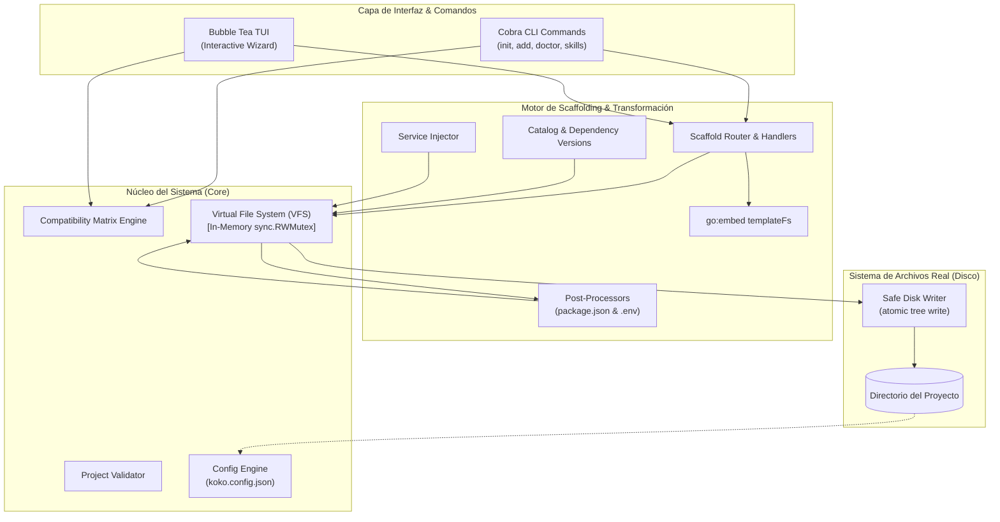
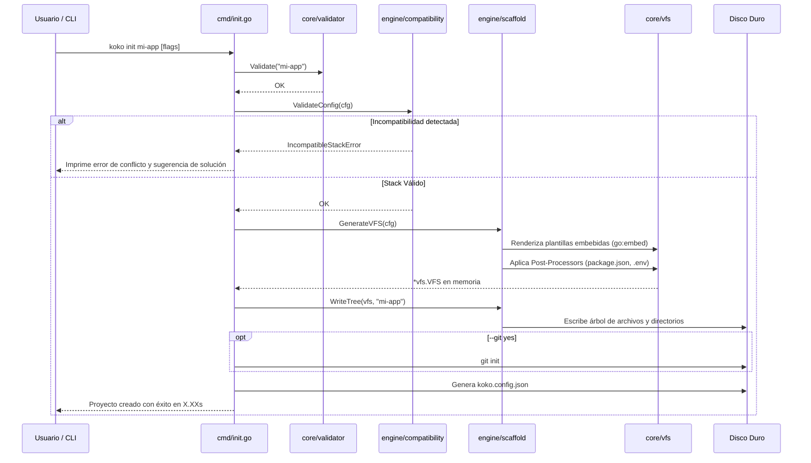
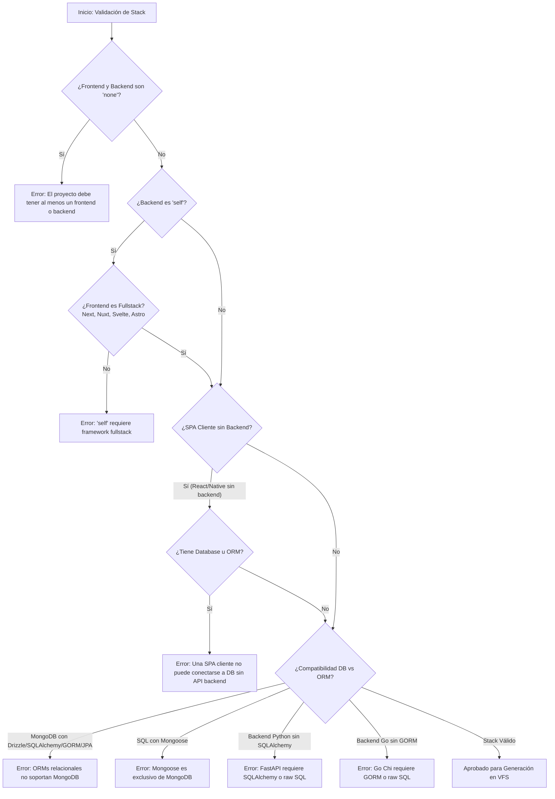

# 🐾 Koko CLI — Documentación Técnica de Arquitectura y Referencia

> **Versión**: v2.0  
> **Estado**: Producción / Sprint Activo  
> **Autor / Maintainer**: Blas Vernazza ([@BlasVernazza06](https://github.com/BlasVernazza06))  

---

## 1. 🎯 Visión General y Propósito

**Koko CLI** es un generador y orquestador moderno de scaffolding para arquitecturas de software de alto rendimiento y grado de producción. Diseñado para erradicar la fricción y el boilerplate repetitivo al iniciar nuevos proyectos, Koko combina la velocidad y solidez nativa de **Go** con una experiencia de desarrollo interactiva y enriquecida mediante terminal (**TUI con Bubble Tea** y ejecución directa vía CLI flags con Cobra).

### Objetivos Clave
- **Monorrepos y Standalone Listos para Producción**: Genera estructuras completas basadas en **Turborepo**, pnpm/npm workspaces, gestión centralizada de TypeScript (`packages/tsconfig`), UI compartida (`packages/ui` con shadcn & Tailwind CSS), capas de datos seguras (`packages/db`) y contratos de autenticación (`packages/auth`).
- **Arquitectura In-Memory sin Efectos Secundarios**: Mediante un sistema de archivos virtual (**VFS**), valida y renderiza todos los templates, resuelve dependencias e inyecta variables antes de realizar una sola escritura en disco. Si hay un fallo de compatibilidad o de renderizado, el sistema de archivos del usuario permanece 100% inalterado.
- **Validación Estricta de Matrices de Compatibilidad**: Previene combinaciones incompatibles de tecnologías (por ejemplo: SPA cliente sin backend intentando conectarse a Postgres, o intentar usar un ORM de TypeScript en un backend Python).
- **Ciclo de Vida Continuo (Day-2 Operations)**: No termina tras el scaffolding inicial. Provee `koko add` para inyectar servicios (Stripe, Polar, Resend, Docker, shadcn, etc.) en proyectos existentes, `koko doctor` para diagnosticar y sincronizar discrepancias entre el código y el manifiesto `koko.config.json`, y `koko skills` para aprovisionar automáticamente habilidades de agentes de Inteligencia Artificial (Cursor, Claude Code, GitHub Copilot).

---

## 2. 🏛️ Arquitectura del Proyecto

Koko-cli está construido siguiendo los principios de la arquitectura limpia en Go, separando claramente la interfaz de usuario (CLI y TUI), los subsistemas centrales de memoria y validación (Core), y los motores de orquestación, resolución e inyección (Engine).



### Estructura de Directorios

```
Koko-cli/
├── cmd/                               # Definición de comandos Cobra
│   ├── root.go                        # Comando raíz 'koko' e invocación a la TUI por defecto
│   ├── init.go                        # Comando 'koko init' (flags manuales o wizard)
│   ├── add.go                         # Comando 'koko add <addon>'
│   ├── doctor.go                      # Comando 'koko doctor [--fix]'
│   └── skills.go                      # Comando 'koko skills' (integración autoskills)
│
├── internal/
│   ├── core/                          # Primitivas transversales y fundamentos
│   │   ├── vfs/                       # Virtual File System en memoria
│   │   ├── validator/                 # Reglas de validación para nombres de proyecto/paquetes
│   │   ├── errors/                    # Tipos de errores enriquecidos y estructurados
│   │   ├── config/                    # Serialización y parseo de koko.config.json
│   │   └── types/                     # Tipos de datos compartidos (ScaffoldConfig)
│   │
│   ├── engine/                        # Motor de generación y templating
│   │   ├── catalog/                   # Catálogo de versiones exactas de librerías y tooling
│   │   ├── compatibility/             # Matriz de compatibilidad y reglas lógicas de dependencias
│   │   ├── injector/                  # Inyección dinámica de servicios en proyectos existentes
│   │   └── scaffold/                  # Orquestador del scaffolding
│   │       ├── handlers/              # Enrutadores específicos (Frontend, Backend, DB, etc.)
│   │       ├── processors/            # Mutadores de package.json, scripts y .env en VFS
│   │       ├── recipes/               # Recetas completas empaquetadas (SaaS, MERN, etc.)
│   │       ├── templates/             # Plantillas base (Go embed FS)
│   │       ├── engine.go              # Renderizador de Go templates y orquestador del VFS
│   │       ├── router.go              # Decision engine para rutas de destino
│   │       └── writer.go              # Volcado seguro y atómico del VFS a disco
│   │
│   ├── features/                      # Capacidades avanzadas
│   │   ├── doctor/                    # Análisis estático del stack, diffing y autofix
│   │   └── skills/                    # Orquestador y runners para autoskills (AI agent skills)
│   │
│   └── tui/                           # Interfaz de usuario de terminal
│       ├── views/                     # Componentes Bubble Tea (Modo, Wizard, Manual, Runner)
│       ├── spinner.go                 # Animaciones de carga
│       └── tui.go                     # Loop principal de Bubble Tea
│
├── npm/                               # Empaquetado multiplataforma para distribución vía npm
└── docs/                              # Documentación técnica del proyecto
```

### Virtual File System (VFS) en Profundidad
El [`VFS`](file:///c:/Users/USUARIO/Desktop/Programacion/Proyects/KokoProject/Koko-cli/internal/core/vfs/vfs.go) implementa un buffer seguro para hilos (`sync.RWMutex`) donde las rutas se normalizan automáticamente a formato UNIX relativo (`path/to/file.ext`):
1. **Normalización**: Previene divergencias de barras entre Windows (`\`) y Linux/macOS (`/`).
2. **Operaciones en Memoria**: Soporta `WriteFile`, `ReadFile`, `WriteString`, `ReadString`, `WriteJSON`, `ReadJSON`, `DeleteFile`, `Exists`, `ListFiles` y `Clear`.
3. **Escritura Atómica en Disco**: El componente [`writer.go`](file:///c:/Users/USUARIO/Desktop/Programacion/Proyects/KokoProject/Koko-cli/internal/engine/scaffold/writer.go) toma el árbol resultante y escribe recursivamente directorios y archivos usando permisos POSIX estándar (`0755` para carpetas, `0644` para archivos).

### Go Templates con Delimitadores Personalizados
Para evitar colisiones sintácticas con templates de JavaScript/TypeScript, Vue, Jinja o JSX, el motor de templates de Koko configura delimitadores personalizados:
- **Sintaxis**: `[[ .ProjectName ]]`, `[[ if hasAddon "docker" ]] ... [[ end ]]`
- **Helpers embebidos**: `version`, `contains`, `hasPrefix`, `hasSuffix`, `lower`, `upper`, `hasAddon`, `hasAuth`, `hasPayment`, `hasEmail`, `hasDB`, `isORM`, `isFrontend`, `isBackend`, `isAPI`.

---

## 3. ⚙️ Configuración y Setup Inicial

### Requisitos del Sistema
- **Go**: 1.21 o superior (para compilar desde código fuente).
- **Node.js**: v18+ (con `npm`, `pnpm` o `bun` disponible en el `PATH` para la ejecución de proyectos y uso de `koko skills`).
- **Git**: Opcional, pero recomendado para inicialización automática de repositorios.

### Instalación

#### Vía NPM / NPX (Recomendado para usuarios de JavaScript/TypeScript)
```bash
npx koko-cli init mi-proyecto
# O instalación global:
npm install -g koko-cli
koko init mi-proyecto
```

#### Compilación desde Fuente (Go)
```bash
git clone https://github.com/BlasVernazza06/koko-cli.git
cd koko-cli
go build -o koko.exe main.go   # En Windows
go build -o koko main.go       # En Linux / macOS
```

### Manifiesto Central: `koko.config.json`
Todo proyecto gestionado por Koko posee un archivo de metadatos tipado en su raíz que describe con exactitud el estado del stack:

```json
{
  "$schema": "https://koko-cli.dev/schema.json",
  "project": {
    "name": "my-saas-app",
    "cliVersion": "v2.0",
    "createdAt": "2026-10-27T10:00:00Z"
  },
  "architecture": {
    "layout": "monorepo",
    "packageManager": "pnpm"
  },
  "stack": {
    "frontend": {
      "framework": "next",
      "language": "typescript",
      "styling": "tailwindcss",
      "uiLibrary": "shadcn",
      "icons": "lucide"
    },
    "backend": {
      "framework": "next",
      "language": "typescript"
    },
    "api": {
      "layer": "trpc"
    },
    "database": {
      "provider": "postgres",
      "orm": "drizzle"
    }
  },
  "features": {
    "auth": {
      "provider": "better-auth",
      "status": "installed"
    },
    "payments": {
      "provider": "stripe"
    },
    "email": {
      "provider": "resend"
    },
    "infrastructure": {
      "dockerCompose": true,
      "ciCd": "github-actions"
    }
  }
}
```

---

## 4. 📖 Catálogo Completo de Comandos y Subcomandos

### 4.1. `koko` (Root)
Lanza la interfaz interactiva completa (**TUI**) construida con Bubble Tea y Lip Gloss cuando no se pasan subcomandos.

```bash
koko
```

---

### 4.2. `koko init [nombre]`
Inicializa un nuevo proyecto. Puede operar en modo interactivo (TUI), modo preset rápido (`--default` / `--recipe`) o mediante flags manuales completos para pipelines desatendidos o CI/CD.

```bash
koko init mi-app [flags]
```

#### Tabla de Flags de `init`
| Flag Corto | Flag Largo | Tipo | Valor por Defecto | Descripción |
| :--- | :--- | :--- | :--- | :--- |
| `-d` | `--default` | `bool` | `false` | Genera directamente usando la receta por defecto (**SaaS Starter**) |
| `-r` | `--recipe` | `string` | `"saas"` | Selecciona un preset: `saas`, `java_spring`, `enterprise_nestjs`, `mern`, `pern`, `fastapi_react`, `mobile_expo` |
| | `--recipie` | `string` | `""` | Alias de conveniencia para `--recipe` |
| `-f` | `--frontend` | `string` | `""` | Framework frontend (`nextjs`, `react`, `nuxt`, `svelte`, `astro`, `native`, `none`) |
| `-b` | `--backend` | `string` | `""` | Framework backend (`express`, `hono`, `fastapi`, `go_chi`, `spring_boot`, `nestjs`, `self`, `none`) |
| | `--api` | `string` | `""` | Capa API de tipos compartidos (`trpc`, `orpc`, `none`) |
| `-p` | `--package-manager` | `string` | `"pnpm"` | Gestor de paquetes (`pnpm`, `npm`, `bun`, `pip`, `uv`, `mvn`, `gradle`, `go_mod`) |
| | `--database` | `string` | `""` | Motor de base de datos (`postgres`, `mongodb`, `mysql`, `sqlite`, `none`) |
| | `--orm` | `string` | `""` | ORM / Mapper (`drizzle`, `prisma`, `mongoose`, `sqlalchemy`, `gorm`, `jpa`, `none`) |
| | `--auth` | `string` | `""` | Proveedor de autenticación (`better-auth`, `clerk`, `next-auth`, `none`) |
| | `--payments` | `string` | `""` | Proveedor de pagos (`stripe`, `polar`, `none`) |
| | `--email` | `string` | `""` | Proveedor de envío de emails (`resend`, `brevo`, `none`) |
| | `--addons` | `string` | `""` | Herramientas separadas por coma (`shadcn,lucide,svgl,motion,zod,docker,github_actions`) |
| | `--git` | `string` | `"no"` | Inicializa repositorio Git (`yes`, `no`) |

#### Ejemplos de Uso
```bash
# 1. Crear proyecto SaaS por defecto en segundos
koko init my-startup -d

# 2. Inicializar usando un preset específico
koko init enterprise-portal -r enterprise_nestjs

# 3. Scaffolding manual personalizado desatendido
koko init my-platform \
  --frontend nextjs \
  --backend hono \
  --api orpc \
  --database postgres \
  --orm drizzle \
  --auth better-auth \
  --payments stripe \
  --email resend \
  --addons "shadcn,lucide,motion,docker,github_actions" \
  --package-manager pnpm \
  --git yes
```

#### Flujo Interno de Ejecución de `init`


---

### 4.3. `koko add <addon>`
Permite inyectar de forma segura herramientas, librerías y servicios en un proyecto Koko existente sin destruir ni sobreescribir archivos manuales.

```bash
koko add <addon> [--dir <path>]
```

#### Addons Soportados
| Addon | Tipo | Efecto en el Proyecto |
| :--- | :--- | :--- |
| `stripe` | Pagos | Inyecta dependencias de `@stripe/stripe-js` / `stripe`, actualiza `koko.config.json` y configura variables en `.env` |
| `polar` | Pagos | Configura `@polar-sh/sdk` para cobros y licencias de software digital |
| `resend` | Email | Agrega `resend` y `@react-email/components` |
| `brevo` | Email | Inyecta clientes de envío transaccional de Brevo |
| `shadcn` | UI | Configura utilidades de Tailwind CSS, componentes base y aliases en `packages/ui` |
| `lucide` | Iconos | Inyecta `lucide-react` en componentes compartidos |
| `svgl` | Iconos | Integra catálogo de logos de marcas y tecnologías |
| `motion` | Animación | Configura `framer-motion` |
| `zod` | Tipado | Inyecta `zod` para validación de esquemas |
| `docker` | DevOps | Añade `docker-compose.yml` para base de datos y servicios locales |
| `github_actions` | CI/CD | Añade `.github/workflows/ci.yml` configurado para monorrepos Turborepo |

---

### 4.4. `koko doctor`
Herramienta de introspección y observabilidad del stack. Realiza un análisis estático profundo del código fuente, dependencias en `package.json`, variables de entorno y esquemas para detectar desviaciones respecto al manifiesto original.

```bash
koko doctor [--fix] [--dir <path>]
```

#### Flags
- `-f`, `--fix`: Sincroniza y repara automáticamente el archivo `koko.config.json` agregando, modificando o eliminando los nodos que hayan cambiado.
- `-d`, `--dir`: Directorio destino a inspeccionar (por defecto `.`).

#### Flujo de Diagnóstico
1. Lee `koko.config.json` si existe (si no existe, lo planifica para creación).
2. Inspecciona el sistema de archivos real identificando si es un monorrepo Turborepo o standalone.
3. Detecta la presencia de frameworks (Next.js, Vite, Nuxt, Svelte, Express, Hono, FastAPI, etc.).
4. Detecta proveedores de base de datos (PostgreSQL, Mongo, MySQL) y ORM configurado (Drizzle, Prisma, etc.).
5. Calcula las diferencias categorizadas:
   - `+ [ADDED]`: Módulos o dependencias agregadas manualmente por el desarrollador.
   - `~ [MODIFIED]`: Cambios de versiones o configuraciones de frameworks.
   - `- [REMOVED]`: Módulos eliminados.
6. Si se proporciona `--fix`, actualiza el manifiesto sin alterar la fecha de creación del proyecto.

---

### 4.5. `koko skills`
Integración nativa con **autoskills** (herramienta del ecosistema creada por midudev). Detecta el stack de tecnologías configurado en el proyecto e instala automáticamente las especificaciones e instrucciones de habilidades para asistentes de código con IA.

```bash
koko skills [flags] [args...]
```

#### Soporte de Asistentes AI
- **Cursor** (`.cursor/rules` o `.cursorrules`)
- **Claude Code** (`CLAUDE.md`)
- **GitHub Copilot**
- **Windsurf**, entre otros.

#### Flags
- `-y`, `--yes`: Acepta automáticamente las confirmaciones interactivas.
- `--dry-run`: Muestra las skills que se instalarían sin modificar ningún archivo.
- `-a`, `--agent <agent>`: Fuerza un agente específico (ej: `cursor`, `claude`, `copilot`).
- `-d`, `--dir`: Directorio del proyecto destino.

---

## 5. 🧱 Servicios, Stacks y Presets Soportados

### 5.1. Presets y Recetas Incluidas (`--recipe`)

| Receta | Frontend | Backend | API / RPC | Base de Datos | ORM | Auth | Monorrepo |
| :--- | :--- | :--- | :--- | :--- | :--- | :--- | :--- |
| `saas` *(Default)* | Next.js 15 | Next.js Server | tRPC | PostgreSQL | Drizzle | Better-Auth | Turborepo |
| `enterprise_nestjs` | Next.js 15 | NestJS | REST / OpenAPI | PostgreSQL | Prisma | Better-Auth | Turborepo |
| `java_spring` | React + Vite | Spring Boot 3 | REST | PostgreSQL | Spring Data JPA | JWT / Spring Security | Workspaces |
| `fastapi_react` | React + Vite | FastAPI (Python) | REST / OpenAPI | PostgreSQL | SQLAlchemy | OAuth2 / JWT | Multi-service |
| `mern` | React + Vite | Express | REST | MongoDB | Mongoose | JWT | Workspaces |
| `pern` | React + Vite | Express | REST | PostgreSQL | Prisma | JWT | Workspaces |
| `mobile_expo` | React Native / Expo | Express | REST | PostgreSQL | Prisma | JWT | Turborepo |

---

### 5.2. Matriz de Validación de Compatibilidad (`compatibility.go`)

Koko cuenta con un motor de reglas semánticas que valida cualquier selección manual en tiempo real:



#### Reglas de Validación Esenciales:
1. **Regla de Existencia**: No se permite crear un proyecto con frontend y backend simultáneamente en `none`.
2. **Regla Fullstack `self`**: El backend `self` delega las rutas de API y Server Actions al framework frontend; por ende, requiere obligatoriamente `nextjs`, `nuxt`, `svelte` o `astro`.
3. **Aislamiento de SPAs Cliente**: Un frontend cliente puro (`react` con Vite o `native` con Expo) sin backend tiene prohibida la asignación directa de bases de datos u ORMs.
4. **Coherencia Motor SQL vs NoSQL**:
   - `mongodb` únicamente admite `mongoose`, `prisma` o `none`.
   - `postgres`, `mysql` y `sqlite` admiten `drizzle`, `prisma`, `sqlalchemy` (Python), `gorm` (Go) o `jpa` (Java).
5. **Ecosistema de Autenticación**:
   - `better-auth`: Requiere entorno Node.js / TypeScript.
   - `clerk`: Requiere entorno React (Next.js, Vite o Expo).
   - `next-auth`: Exclusivo para Next.js.
6. **Capa API**:
   - `trpc`: Requiere ecosistema TypeScript completo y frontend React.
   - `orpc`: Compatible con TypeScript multivariante (incluyendo Vue/Nuxt, Svelte y Astro).

---

## 6. 🚀 Roadmap & Próximas Mejoras (Sprint Activo)

Esta sección documenta las iniciativas técnicas planificadas para el sprint activo y subsiguientes. Se actualiza de forma incremental e in-place.

### 📌 Épicas del Sprint Actual

- [x] **1. Comando Nativo `koko skills` & Arquitectura de AI Agent Skills**:
  - *Contexto*: Integración nativa del orquestador de AI Agent Skills (Cursor, Claude Code, Copilot) con catálogo embebido `go:embed`, caché local offline, detección heurística de stack/file-tree y motor de Combo Skills inteligentes.
  - *Archivos impactados*: `cmd/skills.go`, `internal/features/skills/*`, `internal/tui/views/skills.go`.

- [ ] **2. Soporte de GraphQL y Apollo Server / Yoga en la Capa de API**:
  - *Contexto*: Proveer una alternativa a tRPC/oRPC para stacks que demandan schemas federados o consultas GraphQL flexibles.
  - *Archivos a impactar*: `internal/engine/compatibility/compatibility.go`, `internal/engine/scaffold/handlers/api.go`, `internal/engine/scaffold/templates/api/`.

- [x] **2. Plugin Koko MCP Server (Model Context Protocol)**:
  - *Contexto*: Permitir que modelos LLM y agentes autónomos utilicen herramientas nativas de Koko directamente para consultar opciones, validar stacks e inicializar proyectos programáticamente.
  - *Archivos a impactar*: Nuevos paquetes en `internal/features/mcp/` y `cmd/mcp.go`.

- [ ] **3. Inyección de Módulos de Testing Automatizado**:
  - *Contexto*: Agregar soporte desatendido para Vitest, Playwright y Jest durante el scaffolding inicial o vía `koko add vitest` / `koko add playwright`.
  - *Archivos a impactar*: `internal/engine/injector/injector.go`, `internal/engine/scaffold/templates/addons/`.

- [ ] **4. Telemetría Local y Health Check Extendido en `koko doctor`**:
  - *Contexto*: Verificación de puertos en conflicto, versiones instaladas de Node/Docker y diagnóstico de migraciones pendientes en bases de datos locales.
  - *Archivos a impactar*: `internal/features/doctor/analyzer.go`, `internal/features/doctor/doctor.go`.

- [x] **5. Koko Skills (autoskills midudev)**:
  - *Contexto*: Le permite al usuario la incorporacion de skills para su proyecto y asi obtener un rendimiento mucho mas efectivo y certero para con las tareas realizadas por los agentes. Por debajo estará utilizando el comando de midudev autoskills, que audita el proyecto que estas realizando y busca las skills que mejor se adecuen a tus necesidades.
  - *Archivos a impactar*: Nuevos paquetes en `internal/features/mcp/` y `cmd/mcp.go`.

- [] **6. koko db**:
  - *Contexto*: Implementar un command wrapper para comandos de database (koko db [migrate|seed|studio|reset]) que lee el koko.config.json y ejecuta el comando apropiado sin importar si el proyecto usa Prisma o Drizzle o Mongoose
  - *Archivos a impactar*: Nuevos paquetes en `cmd/db.go`.
